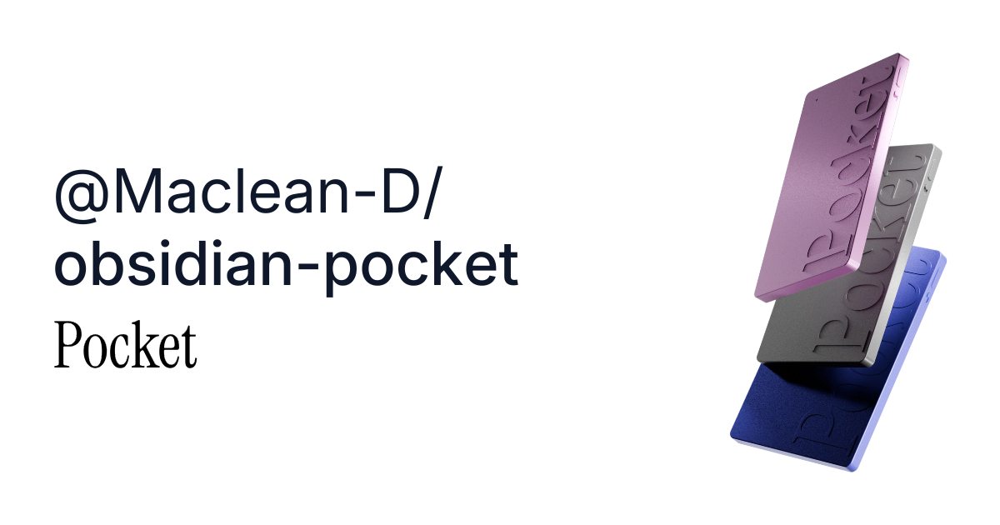

# Pocket Sync for Obsidian

Sync Pocket AI conversations and insights into Markdown notes.

## Features

- Sync conversations as separate artifact files or as one combined Markdown note
- Sync insights tagged with `highlights`
- Auto-sync, startup sync, and manual sync
- Custom folders and filename templates
- Writes Pocket metadata as normal Obsidian properties
- Keeps note content in a managed block so you can add your own notes around it

## Setup

1. Generate a Pocket API key at [Pocket API keys](https://app.heypocket.com/app/settings/api-keys)
2. Open **Settings → Community plugins → Pocket Sync**
3. Paste your API key
4. Click `Test connection`
5. Click `Sync now` or use the ribbon button

## Conversation output formats

**Separate files** is the default. Each conversation keeps its existing folder layout and can contain separate `transcript.md`, `summary.md`, `action-items.md`, and `mindmap.md` files according to the enabled content settings.

**Single note** creates one Markdown note directly under the configured conversations folder. It does not create year/month, date, or per-conversation folders, even when **Group by year and month** is enabled. The note uses the conversation name template for its initial filename and combines available enabled content in this order:

1. Summary
2. Action items
3. Mind map
4. Transcript

The global **Conversation output format** setting applies only when Pocket Sync first encounters an untracked conversation. Already tracked conversations keep their active format, so changing the setting does not convert existing history between Separate files and Single note.

### Moving or renaming Single notes

After creation, a Single note can be renamed or moved anywhere inside the same Obsidian vault. Pocket Sync tracks moves and renames made while the plugin is active and continues updating the note at its new path. Its original generated filename is not reapplied.

If a move happens while Pocket Sync is disabled or Obsidian is closed, Pocket Sync searches Markdown frontmatter for one exact, unambiguous matching `recording_id`. A unique match repairs the tracked path. If no match or multiple matches exist, Pocket Sync skips the recording and does not guess or create a replacement inbox note. Details are available through the **Open last sync report** command.

Every Single note retains `recording_id` as required identity metadata, even when optional Pocket frontmatter is disabled. Pocket Sync uses this value to associate the note safely with its Pocket recording.

Existing Separate-file conversations are not automatically converted to Single notes. Historical migration or adoption is not included in this feature.

## Default output

- Conversations: `Pocket/Conversations/{YYYY-MM-DD}/{Title}`
- Insights: `Pocket/Insights`
- Conversation format: Separate files
- Conversation artifacts: `transcript.md`, `summary.md`, `action-items.md`, `mindmap.md` when enabled and available
- Insight filename: `{{date}} {{title}}`

## Notes

- Imported notes contain copies of your Pocket data
- Your API key is stored in local Obsidian plugin data
- No telemetry
- No backend
- No audio downloads

## Star History

<a href="https://www.star-history.com/?repos=Maclean-D%2Fobsidian-pocket&type=date&legend=top-left">
 <picture>
   <source media="(prefers-color-scheme: dark)" srcset="https://api.star-history.com/chart?repos=Maclean-D/obsidian-pocket&type=date&theme=dark&legend=top-left&sealed_token=bQ2gRdsBH0tI8lR9ga2JWWotRgUogo6c44XCbt1x4HLSs2W4ANfv_EM3clwMuNaAZOEVZloj6tP1DKgIxxQvyPm7lxVPO8OVYrlX-HvXIMtmfpKJO7nIcE8FAuECOIvvJ4hW4i8wXKbDo9urMQfDTeLdl5YwLoBG7JitHY46Zo5pHBBn-AUkYDLWG1rC" />
   <source media="(prefers-color-scheme: light)" srcset="https://api.star-history.com/chart?repos=Maclean-D/obsidian-pocket&type=date&legend=top-left&sealed_token=bQ2gRdsBH0tI8lR9ga2JWWotRgUogo6c44XCbt1x4HLSs2W4ANfv_EM3clwMuNaAZOEVZloj6tP1DKgIxxQvyPm7lxVPO8OVYrlX-HvXIMtmfpKJO7nIcE8FAuECOIvvJ4hW4i8wXKbDo9urMQfDTeLdl5YwLoBG7JitHY46Zo5pHBBn-AUkYDLWG1rC" />
   
 </picture>
</a>

## Contributors

