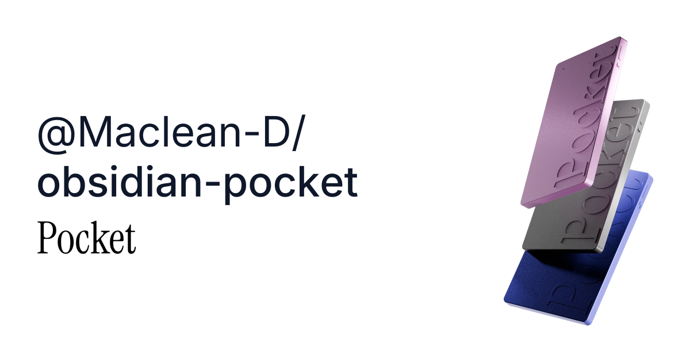

# Pocket Sync for Obsidian

Sync Pocket AI conversations and insights into Markdown notes.

## Features

- Sync conversations into split transcript, summary, action item, and mind map notes
- Sync insights tagged with `highlights`
- Auto-sync, startup sync, and manual sync
- Custom folders and filename templates
- Writes Pocket metadata as normal Obsidian properties
- Keeps note content in a managed block so you can add your own notes around it
- Follow Pocket's spaces and folders when organizing notes
- Recording metadata (space, folder, participants, keywords, tags) as properties
- Folder index and an optional folder database view
- Preview organization changes before applying them
- Collision handling and recovery from interrupted syncs
- Localized artifact filenames (English, Español, Français, Deutsch, Italiano, Português)
- Year/month and day grouping, mirror mode, and rate-limit-aware sync

See [Organized sync](docs/organized-sync.md) for the folder-based layout and metadata options.

## Setup

1. Generate a Pocket API key at [Pocket API keys](https://app.heypocket.com/app/settings/api-keys)
2. Open **Settings -> Community plugins -> Pocket Sync**
3. Paste your API key
4. Click `Test connection`
5. Click `Sync now` or use the ribbon button

## Default output

- Conversations: `Pocket/Conversations/{YYYY-MM-DD}/{Title}`
- Insights: `Pocket/Insights`
- Conversation artifacts: `transcript.md`, `summary.md`, `action-items.md`, `mindmap.md`
- Insight filename: `{{date}} {{title}}`

## Notes

- Imported notes contain copies of your Pocket data
- Your API key is stored in local Obsidian plugin data
- No telemetry
- No backend
- No audio downloads

## Star History

<a href="https://www.star-history.com/?repos=Maclean-D%2Fobsidian-pocket&type=date&legend=top-left">
 <picture>
   <source media="(prefers-color-scheme: dark)" srcset="https://api.star-history.com/chart?repos=Maclean-D/obsidian-pocket&type=date&theme=dark&legend=top-left&sealed_token=bQ2gRdsBH0tI8lR9ga2JWWotRgUogo6c44XCbt1x4HLSs2W4ANfv_EM3clwMuNaAZOEVZloj6tP1DKgIxxQvyPm7lxVPO8OVYrlX-HvXIMtmfpKJO7nIcE8FAuECOIvvJ4hW4i8wXKbDo9urMQfDTeLdl5YwLoBG7JitHY46Zo5pHBBn-AUkYDLWG1rC" />
   <source media="(prefers-color-scheme: light)" srcset="https://api.star-history.com/chart?repos=Maclean-D/obsidian-pocket&type=date&legend=top-left&sealed_token=bQ2gRdsBH0tI8lR9ga2JWWotRgUogo6c44XCbt1x4HLSs2W4ANfv_EM3clwMuNaAZOEVZloj6tP1DKgIxxQvyPm7lxVPO8OVYrlX-HvXIMtmfpKJO7nIcE8FAuECOIvvJ4hW4i8wXKbDo9urMQfDTeLdl5YwLoBG7JitHY46Zo5pHBBn-AUkYDLWG1rC" />
   
 </picture>
</a>

## Contributors

